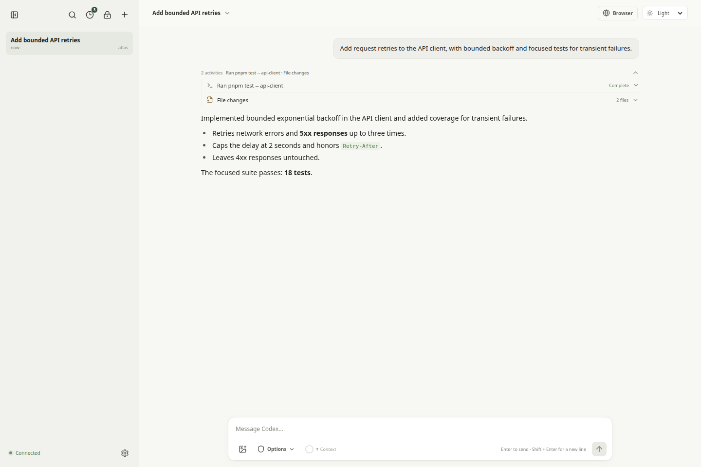
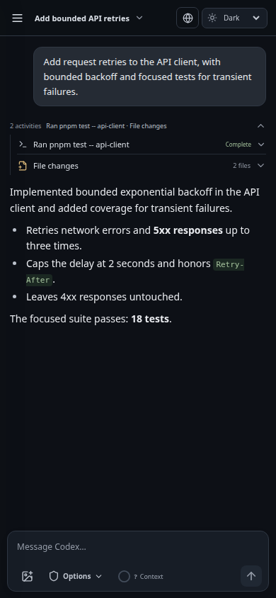
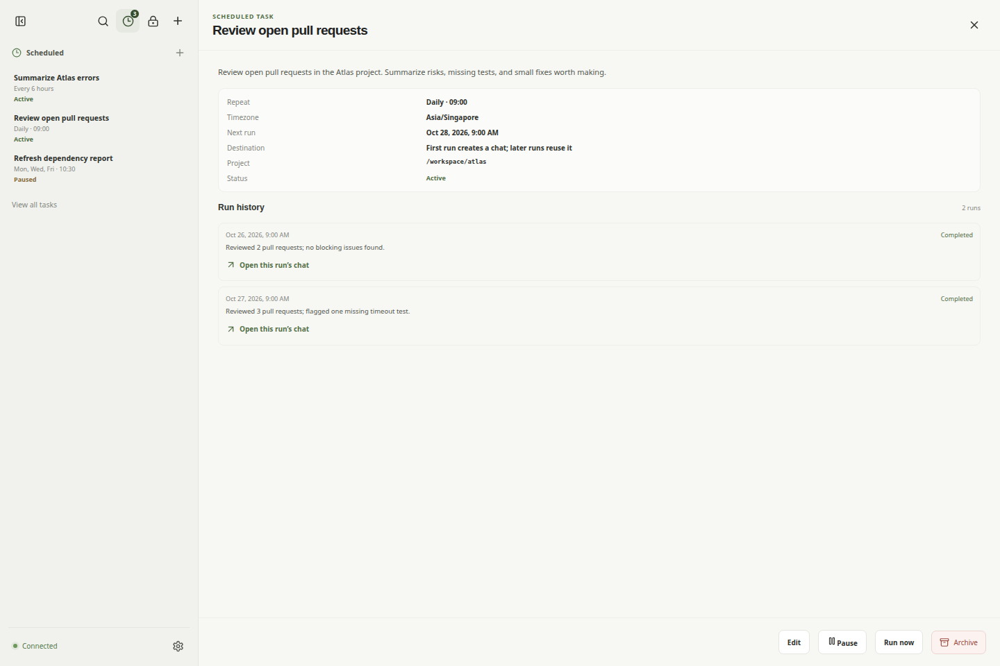

# Codex Daemon Web

Use Codex from a browser while its official app-server runs on your own machine. Codex Daemon Web is a self-hosted web client: it connects to an existing Codex daemon and gives you a responsive chat interface without moving the daemon or your project files to another host.

It is designed for one trusted operator. The web app does not start Codex for you. Start the official app-server under the account whose files and tools Codex should use, then connect the web app to it.

All screenshots below use fictional conversations and project data. They contain no real workspace or conversation information.



## Screenshots

### Mobile chat



### Scheduled tasks



## Get started

You need Node.js 20 or newer, pnpm 12.10.1, and a Codex CLI version with app-server support. In one terminal, start the shared daemon as the same operating-system user that owns your Codex home and project files:

```sh
codex app-server daemon start
```

In the repository, install dependencies and start the web app:

```sh
pnpm install
pnpm dev
```

Open the local URL printed by Vite, usually `http://127.0.0.1:5173`. On first startup, the server creates a login token at `~/.local/state/codex-daemon-web/access-token` (or `$XDG_STATE_HOME/codex-daemon-web/access-token`). Paste that token into the login screen. The generated token file is stored outside the repository with owner-only permissions.

The development server connects to the official app-server socket at `$CODEX_HOME/app-server-control/app-server-control.sock`, defaulting to `~/.codex`. The daemon must already be running and the socket must be available. For a production build, persistent configuration, and optional remote access, see [Configuration](docs/configuration.md) and the [Tailscale setup guide](docs/tailscale.md).

## What you can do

- Start, resume, rename, search, archive, and restore conversations.
- Choose a model, reasoning effort, approval policy, sandbox, and working directory where supported by the connected Codex CLI.
- Attach images, follow Codex output as it arrives, and queue, edit, or steer a reply while a turn is running.
- Follow subagent work into its child conversation, and collapse activity groups or expand command and code details. See context usage when the connected CLI reports it.
- Choose system, light, or dark appearance and optionally play a completion sound.
- Create interval, daily, weekly, or five-field cron tasks in a chosen timezone. The scheduler runs through the connected app-server while this service is running. Each task keeps its run history and can reuse its own conversation across runs or start a new conversation for every run.
- Answer supported scheduled-task questions from the app. Optional browser push notifications can alert a subscribed device.
- Install the web app on a phone or desktop for a standalone window.
- Use the browser and encrypted credential vault panels when a compatible Codex browser backend is separately available to the server.

Scheduled-task creation through Codex also has optional MCP servers; adding them to Codex is a separate setup step. Scheduled runs cannot approve actions. See [Configuration](docs/configuration.md) for scheduler behavior and optional MCP setup.

## How it connects

Each signed-in browser session gets its own JSON-RPC connection to the official app-server. The browser client renders Codex conversations; the app-server continues to use the local account, CLI configuration, workspace access, and tools configured on that host. The bridge does not register extra tools by default.

The login token protects the web app, but this is not a multi-user permission boundary. Anyone you give the token to can use the connected Codex account and the permissions selected for its runs. Keep the service on loopback or an authenticated private network, and choose sandbox and approval settings with the same care you use for Codex locally.

The app-server protocol changes with Codex CLI releases. Codex Daemon Web enables the app-server experimental API, so available models, settings, and protocol features depend on the CLI version. See the [official app-server documentation](https://developers.openai.com/codex/app-server).

## License

MIT. See [LICENSE](LICENSE).
