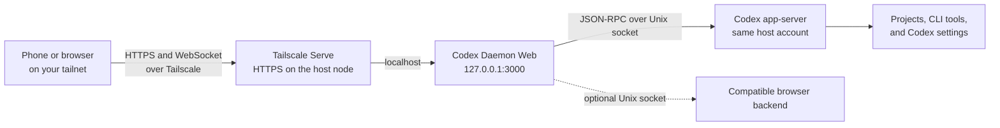

# Private access with Tailscale

This guide serves the production web app to your tailnet with Tailscale Serve. Your phone or laptop must be signed in to the same tailnet and permitted by its access rules. The web app still asks for its login token after the Tailscale connection is established.

Tailscale Serve keeps the service available only to devices that can reach it on your tailnet. It uses HTTPS for the browser connection, including its WebSocket connection to the app. The Codex daemon stays on the host behind the web app.



## 1. Connect the host and phone to Tailscale

Install Tailscale on the host running Codex Daemon Web and on your phone or laptop from [tailscale.com/download](https://tailscale.com/download). Sign both devices into the same tailnet and connect them. On a Linux host, the CLI command is:

```sh
sudo tailscale up
```

You can choose a short machine name for the host, for example:

```sh
sudo tailscale set --hostname=codex
```

This name changes the host's MagicDNS name; the full DNS name also includes your tailnet's domain. Enable MagicDNS and HTTPS certificates in the tailnet settings if they are not already enabled. Tailscale Serve may prompt you to enable HTTPS certificates when you first configure it.

## 2. Start the app-server and web app

On the host, start the Codex app-server as the OS user whose account Codex should use:

```sh
codex app-server daemon start
```

Then build and start the production web app from this repository:

```sh
pnpm install --frozen-lockfile
pnpm build
pnpm start
```

The default production listener is `127.0.0.1:3000`, which is reachable by Tailscale Serve on the same host. The web server connects to the default Codex app-server Unix socket under `~/.codex`. If your Codex home is elsewhere, configure `CODEX_HOME` for the web server.

## 3. Find the host's tailnet DNS name

Enable HTTPS certificates for your tailnet if prompted by Tailscale. Find the node's DNS name in the Tailscale admin console or run:

```sh
tailscale status --json | jq -r '.Self.DNSName | sub("\\.$"; "")'
```

Use the returned full name in the next step. It may look like `codex.<your-tailnet>.ts.net`; use the actual value from your Tailscale node rather than guessing the tailnet domain. `tailscale serve` requires HTTPS and a tailnet DNS name.

## 4. Set the browser origin

Create or update the web app's local `.env` file using the exact hostname from the previous step:

```dotenv
HOST=127.0.0.1
PORT=3000
PUBLIC_URL=https://workstation.example.ts.net
ALLOWED_ORIGINS=https://workstation.example.ts.net
COOKIE_SECURE=true
```

`PUBLIC_URL` and `ALLOWED_ORIGINS` must match the HTTPS origin browsers will open, including any non-default port if you configure one. Restart `pnpm start` after changing `.env`.

## 5. Enable Tailscale Serve

In a separate terminal on the same host, configure Tailscale Serve to proxy HTTPS requests to the local web server:

```sh
tailscale serve --bg http://127.0.0.1:3000
tailscale serve status
```

Open the HTTPS URL printed by `tailscale serve status` from a device connected to your tailnet. Enter the web login token from the server's configured token file. You can install the site from the browser menu to use it as a standalone app on a phone or desktop.

## Access and troubleshooting

Tailscale Serve applies the tailnet's access rules. Restrict which users and devices can reach the node using your tailnet ACLs or grants. Every person who can reach the login page still needs the web token; anyone who has that token can operate the connected Codex account.

- If the app reports that the daemon is unavailable, start the Codex app-server under the same OS account as the web service and confirm that its configured Unix socket exists.
- If login or WebSocket connection fails, make sure `PUBLIC_URL` and `ALLOWED_ORIGINS` exactly match the browser's HTTPS origin, then restart the web service.
- If the Tailscale URL does not open, check that both devices are connected to the tailnet, that its access rules allow the connection, and that `tailscale serve status` shows the expected local target.
- The Browser panel and browser-backed vault filling need a separate compatible browser backend; Tailscale Serve only provides network access to this web app.

This guide uses Tailscale Serve, which makes the service available within your tailnet. Do not configure Tailscale Funnel or another public proxy for this single-operator web app. See [Tailscale Serve documentation](https://tailscale.com/docs/features/tailscale-serve) and the [Serve CLI reference](https://tailscale.com/docs/reference/tailscale-cli/serve) for current requirements and command options.
